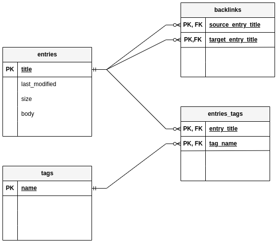

# eolas-db

This CLI application parses entries in my
[zettelkasten](https://github.com/thomasabishop/eolas), extracts the content
and metadata for each entry and inserts it into an SQLite database.

It takes two parameters:

- `--source`
  - A file reference to the location of the markdown files comprising the Zettelkasten
- `--target`
  - A file reference designating where the SQLite file should be saved.

## Local development

```sh
source venv/bin/activate
python3 src/app.py --source="/my-zettelkasten-entries" --target="/tmp/zettelkasten-output-dir"
```

## Production

### Generate single executable

```sh
source venv/bin/activate
pyinstaller --onefile ${HOME}/eolas-db/src/app.py
```

Will build to the `/dist` directory of this repo when run locally.

### Run executable

```sh
${HOME}/eolas-db/dist/app --source="/my-zettelkasten-entries" --target="/tmp/zettelkasten-output-dir"
```

## ERM



## Related projects

### [eolas](https://forgejo.systemsobscure.net/thomasabishop/eolas)

The repository for the Zettelkasten that this application reads from.

### [eolas-api](https://forgejo.systemsobscure.net/thomasabishop/eolas-api)

A NodeJS Express API which sources its data from database created by
this application.

### [eolas-app](https://forgejo.systemsobscure.net/thomasabishop/eolas-app)

A web frontend for the application, deployed at
[eolas-app.systemsobscure.net](https://eolas-app.systemsobscure.net).
